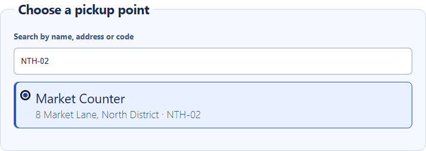
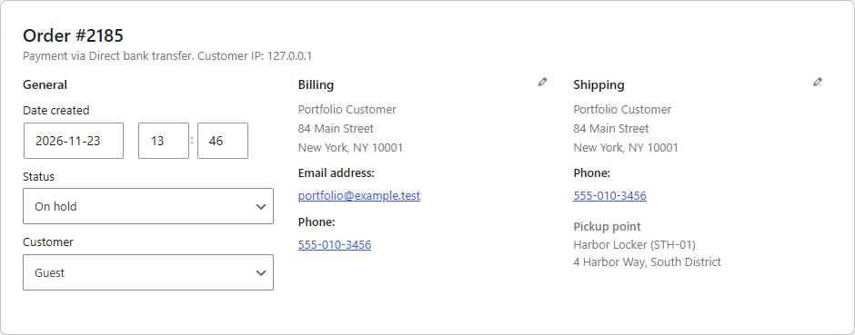

# Pickup Point Checkout for WooCommerce

[](https://github.com/aa71200/woo-pickup-point-checkout/actions/workflows/checks.yml)

Customers need to find a pickup point, and checkout must check that it still matches their shipping address. This CodexaWP sample adds searchable pickup selection to a single-package checkout and saves the validated point on the order.

## Checkout preview

<p align="center">
  <a href="docs/checkout-block.png"></a>
  <br>
  <em>Block checkout · Market Counter selected after searching for NTH-02</em>
</p>

<details>
<summary>View the saved pickup point in the order editor</summary>

<p align="center">
  <a href="docs/order-pickup-point.png"></a>
  <br>
  <em>HPOS order details · stored pickup point and address</em>
</p>

</details>

## Try it in a test store

Download the [verified installation ZIP](https://github.com/aa71200/woo-pickup-point-checkout/releases/tag/v1.0.0) and upload it under **Plugins → Add New → Upload Plugin**, or copy the source as described below.

1. Copy the repository into the `wp-content/plugins/woo-pickup-point-checkout` folder in a WordPress test installation. Activate WooCommerce and **Pickup Point Checkout for WooCommerce**.
2. In **WooCommerce → Settings → Shipping → Shipping zones**, add **Pickup Point Demo** to a zone. Configure its **Sample catalogue** as North District or South District. To test region changes, set up two zones with different destinations and assign a different catalogue to each. Add a normal shipping method to test switching away from pickup.
3. For **Checkout block**, open the checkout page in the editor and insert **Pickup Point Selector** inside **Shipping options**. For **classic checkout**, the picker loads automatically on the page with the WooCommerce checkout shortcode.
4. Add a physical product, enter an address in a configured zone, and select **Pickup Point**. Search for **NTH-02** in the North catalogue or **STH-01** in the South catalogue. Use a test payment method to complete the order.
5. Open the new order under **WooCommerce → Orders** and look for **Pickup point** in the shipping details.

## Implementation

- The native shipping method associates a zone instance with a sample catalogue. Both checkout interfaces use the [same catalogue lookup](includes/catalog.php).
- Classic checkout refreshes the picker with WooCommerce's order review. Checkout Blocks read availability from the [Cart Store API](https://developer.woocommerce.com/docs/apis/store-api/extending-store-api/extend-store-api-add-data/) and submit the selected ID with checkout.
- The server checks that the submitted ID belongs to the current pickup rate. It saves the point's ID, name and address as an order snapshot through WooCommerce's order API, so staff can read the original selection.

## Verification

Run the catalogue checks on PHP 8.2 or newer:

```sh
php tests/catalog.php
```

A local WordPress 7.1.3, WooCommerce 11.1.2 and PHP 8.2.12 fixture exercised search, clearing a selection after shipping-method and region changes, server rejection of an out-of-region selection, and successful test orders in both classic and block checkout. The HPOS order editor displayed the saved pickup point on both orders with legacy table sync disabled.

The demo uses fictional pickup points and fixed regional catalogues. Created for CodexaWP with AI assistance.

## License

GPL-2.0-or-later. See [LICENSE](LICENSE).
